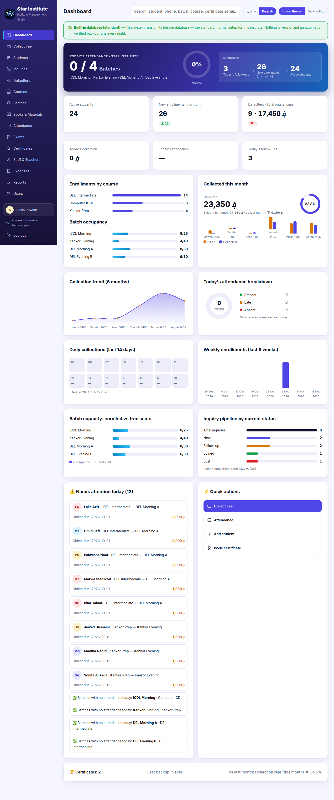

# Institute PRO — Institute & Course Management System

A complete management system for course institutes and academies: students, programmes, fees, attendance, exams and certificates — bilingual (English / Dari) with a Shamsi calendar, offline-first.

## Key features
- Programmes → Levels → Batches, with price snapshots so fee changes never rewrite history
- Full enrolment lifecycle: trial, active, frozen, transfer, repeat, rejoin, promotion and waitlist
- Fees engine: monthly / per-semester / per-level pricing, pro-rated first month, partial payments, printable receipts, defaulters list
- Books & materials sales through the same ledger as fees
- Attendance register with at-risk alerts, exams, certificates, salaries, expenses and profit/loss
- Owner dashboard with charts, role-based access, backup & restore

## Modules
Students & Enrolment · Programmes, Levels & Batches · Fees & Receipts · Books & Materials · Attendance · Exams & Certificates · Salaries & Expenses · Reports & Dashboard

## Tech stack
Python · Django · Django REST Framework | React · Vite · Tailwind CSS | SQLite / MySQL | Flutter / PWA (offline-first)

## About this repository
This is a **showcase repository**. Hospital PRO / Institute PRO / SuperMarket PRO are commercial products of Wakhan Technologies, so the full source code is private. This page documents what the system does and how it is built. Recruiters and clients can request a live demo or a guided code walkthrough — just ask.

- Live portfolio with more screenshots: https://javid-ahmadi-portfolio.vercel.app

## Author
**Ahmad Jawid Ahmadi** — Full Stack Web Developer (React, Django, Flutter), Kabul, working remotely worldwide.
- LinkedIn: https://www.linkedin.com/in/jawid-ahmadi-5a63793ab/
- GitHub: https://github.com/JawidAhmadi77

## Licence
Proprietary — see [LICENSE](LICENSE). Viewing for evaluation only; no copying, deployment or resale.
